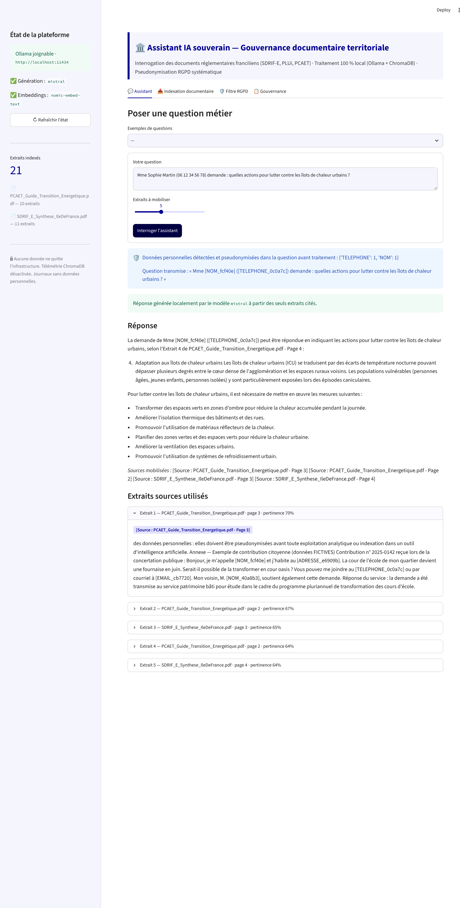
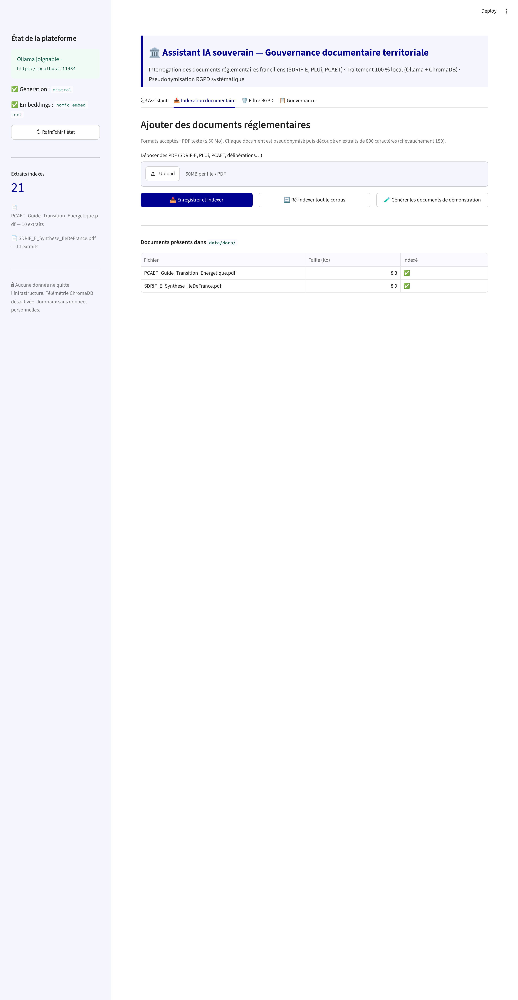
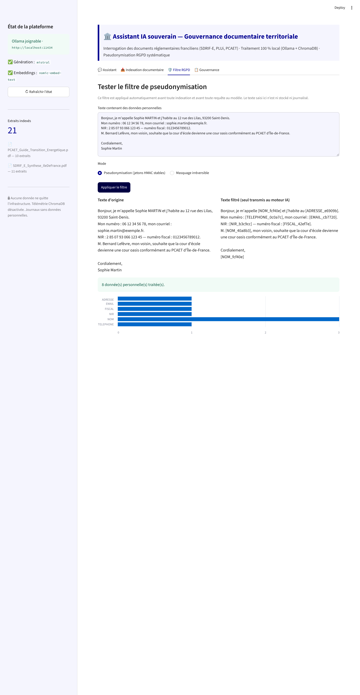

# 🏛️ Assistant IA souverain & gouvernance documentaire

**POC LLM / RAG territorial — Île-de-France**

Assistant d'IA **100 % local et open source** qui permet aux agents des collectivités franciliennes
d'interroger leurs documents réglementaires volumineux (SDRIF-E, PLUi, PCAET…) et d'obtenir des réponses
**sourcées à la page près**, tout en garantissant la **conformité RGPD** : toute donnée personnelle est
pseudonymisée avant d'être indexée ou envoyée au modèle.

> Aucune API cloud propriétaire. Aucune donnée ne quitte l'infrastructure de la collectivité.

---

## 1. Architecture souveraine

```
                    ┌──────────────────────────── Poste / serveur de la collectivité ─────────────────────────────┐
                    │                                                                                               │
  PDF réglementaires│   ┌─────────────┐   ┌──────────────────┐   ┌────────────────┐   ┌──────────────────────┐      │
  (SDRIF-E, PLUi,  ─┼──▶│ pypdf       │──▶│ Filtre RGPD      │──▶│ Découpage      │──▶│ Embeddings           │      │
   PCAET, courriers)│   │ page à page │   │ rgpd_filter.py   │   │ 800 / 150      │   │ nomic-embed-text     │      │
                    │   └─────────────┘   │ (pseudonymisation)│   │ + fichier/page │   │ (Ollama local)       │      │
                    │                     └──────────────────┘   └────────────────┘   └──────────┬───────────┘      │
                    │                                                                            ▼                  │
                    │                                                               ┌──────────────────────┐        │
                    │                                                               │ ChromaDB persistant  │        │
                    │                                                               │ data/chroma_db/      │        │
                    │                                                               └──────────┬───────────┘        │
                    │   ┌───────────────┐   ┌──────────────────┐   recherche cosinus top-k     │                    │
  Question agent  ──┼──▶│ Streamlit     │──▶│ Filtre RGPD      │──────────────────────────────▶│                    │
                    │   │ app.py        │   └──────────────────┘                               ▼                    │
                    │   │               │◀── réponse + [Source : fichier - Page X] ── ┌──────────────────────┐      │
                    │   └───────────────┘                                              │ mistral (Ollama)     │      │
                    │                                                                  │ prompt système strict│      │
                    │                                                                  └──────────────────────┘      │
                    └───────────────────────────────────────────────────────────────────────────────────────────────┘
```

| Brique | Rôle | Technologie (licence) |
|---|---|---|
| Serveur de modèles | Exécution locale des LLM | **Ollama** dans Docker (MIT) |
| Génération | Rédaction de la réponse à partir des extraits | **Mistral 7B** (Apache 2.0) |
| Vectorisation | Embeddings des extraits et des questions | **nomic-embed-text** (Apache 2.0) |
| Base vectorielle | Stockage persistant, similarité cosinus | **ChromaDB** (Apache 2.0) |
| Pipeline | Lecture PDF, découpage | **pypdf**, **LangChain text splitters** |
| Interface | Indexation, test RGPD, questions/réponses | **Streamlit** (Apache 2.0) |
| Gouvernance | Pseudonymisation des PII | `src/rgpd_filter.py` (maison, testé) |

### Garanties fonctionnelles
- **Citations obligatoires** : chaque affirmation porte `[Source : nom_du_fichier - Page X]`. Si le modèle les
  omet, le moteur les ajoute ; l'interface affiche les extraits exacts utilisés et leur page.
- **Pas d'invention** : si aucun extrait pertinent n'est trouvé (seuil de distance), l'assistant répond
  « Les documents indexés ne permettent pas de répondre à cette question. »
- **Mode dégradé** : si Ollama n'est pas démarré ou si un modèle manque, l'assistant bascule sur une
  recherche lexicale locale (BM25) et restitue les extraits pertinents verbatim, avec leurs citations.

---

## 2. Démarche DPO / RGPD

Le détail figure dans **[`GOVERNANCE_RGPD.md`](GOVERNANCE_RGPD.md)** (registre art. 30, base légale,
durées de conservation, politique d'hébergement souverain, analyse de risques, check-list DPO).

En synthèse :
1. **Minimisation à la source** — le filtre est appliqué *avant* le découpage, l'embedding et l'indexation :
   aucune donnée personnelle en clair n'entre dans ChromaDB.
2. **Requêtes filtrées** — la question de l'agent est pseudonymisée *avant* d'être vectorisée ou envoyée au LLM ;
   la réponse du LLM est elle aussi refiltrée.
3. **Pseudonymisation HMAC-SHA256 salée** — jetons stables (`[NOM_3f9a1c]`) sans table de correspondance ;
   mode masquage irréversible disponible.
4. **Souveraineté** — exécution locale, ports liés à `127.0.0.1`, télémétrie ChromaDB/Streamlit désactivée.
5. **Journaux sans PII** — uniquement des compteurs par catégorie.

Données détectées : emails, téléphones français, NIR, numéros fiscaux (SPI), IBAN, adresses postales exactes,
noms de personnes (civilités, prénoms courants, formules « je m'appelle », signatures).

---

## Aperçu de l'interface

> Captures réalisées avec les vrais modèles `mistral` et `nomic-embed-text` (Ollama 0.40.15, processeur seul,
> environ 70 s par réponse). La réponse affichée est brute : elle illustre aussi les limites d'un modèle 7B
> (mesures en partie reformulées hors des extraits) — d'où l'affichage systématique des extraits sources.

| Assistant | Indexation | Filtre RGPD |
|---|---|---|
|  |  |  |

---

## 3. Arborescence

```
projet-1-rag-territorial-idf/
├── app.py                     # Interface Streamlit (4 onglets)
├── docker-compose.yml         # Ollama + volume persistant + pull automatique des modèles (+ app optionnelle)
├── Dockerfile                 # Image de l'interface (profil "app")
├── requirements.txt
├── GOVERNANCE_RGPD.md         # Registre de traitement & politique de souveraineté
├── .env.example               # Variables de configuration
├── .streamlit/config.toml     # Thème institutionnel, télémétrie coupée
├── data/
│   ├── docs/                  # PDF sources (générés ou déposés)
│   └── chroma_db/             # Index vectoriel persistant
├── src/
│   ├── config.py              # Configuration typée (pydantic) + logging
│   ├── rgpd_filter.py         # Détection & pseudonymisation des PII
│   ├── create_sample_docs.py  # Génère 2 PDF de démonstration si data/docs/ est vide
│   ├── ingest.py              # PDF → RGPD → chunks 800/150 → embeddings → ChromaDB
│   ├── ollama_client.py       # Client REST Ollama + fonction d'embedding Chroma
│   ├── vector_store.py        # Accès ChromaDB persistant
│   └── rag_engine.py          # Recherche sémantique + génération + fallback
└── tests/
    └── test_rgpd_filter.py    # Tests unitaires du filtre RGPD
```

---

## 4. Installation et lancement

**Prérequis** : Docker + Docker Compose v2, Python 3.11 ou plus, ~8 Go de RAM libres (Mistral 7B quantifié ≈ 4,1 Go,
nomic-embed-text ≈ 0,3 Go). Un GPU NVIDIA est facultatif (voir le bloc `deploy` commenté dans `docker-compose.yml`).

### 4.1 Démarrer Ollama et télécharger les modèles

```bash
cd projet-1-rag-territorial-idf
```

```bash
docker compose up -d
```

Le service `ollama-init` télécharge automatiquement `nomic-embed-text` et `mistral` dans le volume persistant.
Suivre la progression :

```bash
docker compose logs -f ollama-init
```

Vérifier les modèles installés :

```bash
docker exec ollama ollama list
```

### 4.2 Environnement Python

```bash
python3 -m venv .venv
```

```bash
source .venv/bin/activate
```

```bash
pip install -r requirements.txt
```

```bash
cp .env.example .env
```

Générer un sel secret de pseudonymisation et le reporter dans `RGPD_SALT` du fichier `.env` :

```bash
python -c "import secrets; print(secrets.token_hex(32))"
```

Charger les variables dans le shell courant :

```bash
set -a && source .env && set +a
```

### 4.3 Générer les documents de démonstration et indexer

```bash
python -m src.create_sample_docs
```

```bash
python -m src.ingest
```

(`python -m src.ingest` génère aussi les PDF de démonstration si `data/docs/` est vide ;
`--reset` vide l'index avant ré-indexation ; on peut citer des fichiers précis en argument.)

### 4.4 Lancer l'interface

```bash
streamlit run app.py
```

Ouvrir http://localhost:8501. Onglets disponibles :
- **💬 Assistant** : questions métier, réponse sourcée, extraits et pages exactes ;
- **📥 Indexation documentaire** : dépôt de PDF et indexation en un clic, ré-indexation complète ;
- **🛡️ Filtre RGPD** : test en direct de la pseudonymisation sur un texte libre ;
- **📋 Gouvernance** : affichage du registre RGPD.

### 4.5 Variante tout-conteneur

```bash
docker compose --profile app up -d --build
```

L'interface est alors servie sur http://localhost:8501 et utilise `http://ollama:11434` sur le réseau Docker interne.

### 4.6 Utilisation en ligne de commande

```bash
python -m src.rag_engine "Quels sont les objectifs ZAN pour l'Île-de-France ?"
```

```bash
echo "Je m'appelle Jean DUPONT, 06 12 34 56 78, 12 rue des Lilas 93200 Saint-Denis" | python -m src.rgpd_filter
```

### 4.7 Tests

```bash
pytest -q
```

---

## 5. Exemples de questions

| Question | Document attendu |
|---|---|
| Quels sont les objectifs ZAN fixés pour l'Île-de-France ? | SDRIF-E, p. 1 |
| Comment le PLUi doit-il protéger la trame verte et bleue ? | SDRIF-E, p. 3 |
| Quelles obligations de réduction de consommation pour les bâtiments publics ? | PCAET, p. 1 |
| Quelles actions pour lutter contre les îlots de chaleur urbains ? | PCAET, p. 2 |

L'annexe du PCAET de démonstration contient une contribution d'usager avec des **données personnelles fictives** :
après indexation, les extraits correspondants n'affichent que des jetons (`[NOM_…]`, `[ADRESSE_…]`,
`[TELEPHONE_…]`, `[EMAIL_…]`), ce qui permet de vérifier le filtrage de bout en bout.

---

## 6. Configuration

| Variable | Défaut | Description |
|---|---|---|
| `OLLAMA_HOST` | `http://localhost:11434` | URL du serveur Ollama local |
| `OLLAMA_LLM_MODEL` | `mistral` | Modèle de génération |
| `OLLAMA_EMBED_MODEL` | `nomic-embed-text` | Modèle d'embedding |
| `RAG_TOP_K` | `5` | Nombre d'extraits mobilisés |
| `RAG_MAX_DISTANCE` | `0.65` | Distance cosinus maximale d'un extrait jugé pertinent |
| `RGPD_SALT` | *(à définir)* | Sel secret de la pseudonymisation HMAC |
| `RAG_DOCS_DIR` / `RAG_CHROMA_DIR` | `data/docs` / `data/chroma_db` | Emplacements des données |
| `LOG_LEVEL` | `INFO` | Niveau de journalisation |

> Changer de modèle d'embedding impose une ré-indexation complète : `python -m src.ingest --reset`.

---

## 7. Limites du POC et pistes d'évolution

- **PDF scannés** : non pris en charge (pas d'OCR) → ajouter Tesseract (`ocrmypdf`), open source.
- **Détection des noms** : heuristiques (civilités, prénoms, signatures) → compléter par un NER local
  (spaCy `fr_core_news_lg`) pour les noms sans prénom courant ni civilité.
- **Authentification** : à intégrer (reverse-proxy + SSO de la collectivité) avant toute ouverture aux agents.
- **Évaluation** : constituer un jeu de questions/réponses de référence pour mesurer la fidélité des citations.
- **Documents de démonstration** : synthèses pédagogiques fictives ; seuls les documents officiels publiés
  par la Région Île-de-France et les collectivités font foi.
